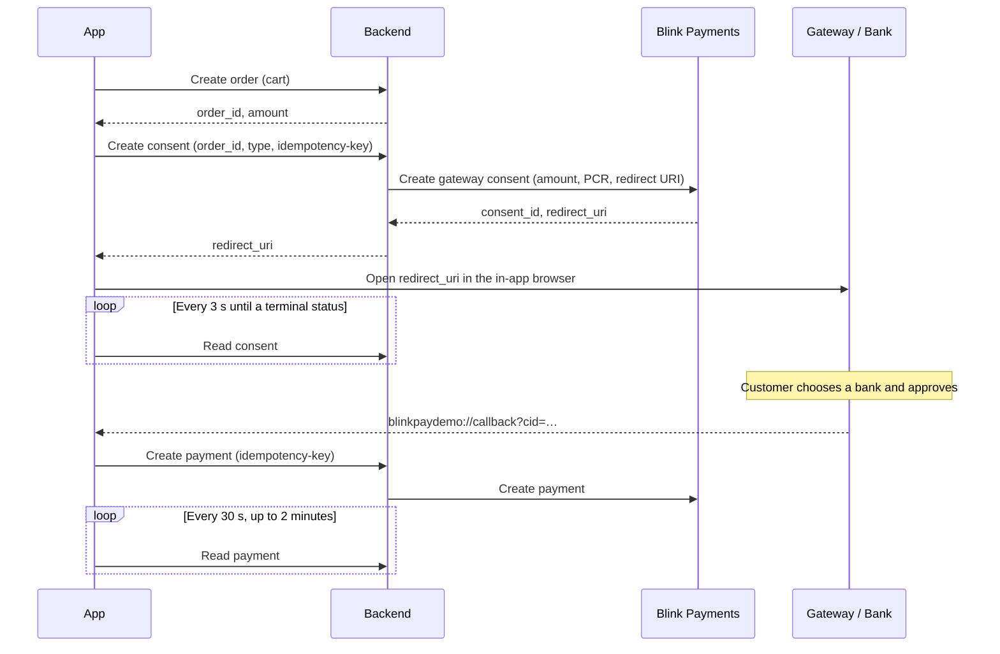

# BlinkPay Flutter Mobile App Demo

A reference implementation of [Blink Payments](https://www.blinkpay.co.nz) in a mobile app. It is written in Flutter, but the patterns are the same for React Native, Swift, Kotlin or any other mobile framework: a backend that holds the credentials and owns the order, the Blink Payments **gateway flow** opened in the system's in-app browser, a custom-scheme return to the app, and outcome handling that waits for the bank instead of guessing.

| Project | Directory | Purpose |
|---|---|---|
| **Flutter app** | Root (`lib/`) | Shopping cart UI: starts a payment, opens the gateway, tracks the outcome |
| **Backend** | `server/` | Dart Shelf server: holds the Blink Payments credentials, prices the order, creates consents and payments |

This is a reference implementation, not an SDK. Read the code, then build the same thing into your own app and backend.

## Quick Start

```bash
git clone https://github.com/BlinkPay/BlinkPay-Flutter-Demo.git
cd BlinkPay-Flutter-Demo
flutter pub get
cp server/.env.example server/.env
# Edit server/.env with your sandbox credentials (see below)
./run.sh
```

The script installs the server dependencies, asks which device you are using, starts the backend and launches the app. Skip the prompt with `./run.sh --simulator`, `--emulator` or `--lan`.

### Credentials

Edit `server/.env`:

```
BLINKPAY_API_URL=sandbox.debit.blinkpay.co.nz
BLINKPAY_CLIENT_ID=your_client_id_here
BLINKPAY_CLIENT_SECRET=your_client_secret_here
APP_API_KEY=                              # Leave empty: run.sh generates one
SERVER_PORT=4567
UNIT_PRICE=1.00
```

In the [Merchant Portal](https://merchants.blinkpay.co.nz/settings/api), under Settings > API, add `blinkpaydemo://callback` to your redirect URIs, copy the client ID, and rotate and copy the secret.

To try it in the sandbox, choose **PNZ** at the gateway and log in as `user01` with password `password`.

<details>
<summary>Manual setup (without run.sh)</summary>

**Terminal 1: the backend**

```bash
cd server && dart pub get && dart run bin/server.dart
```

**Terminal 2: the app**

```bash
flutter run \
  --dart-define=BACKEND_URL=http://10.0.2.2:4567 \
  --dart-define=APP_API_KEY=your_api_key_from_server_env
```

Use the right `BACKEND_URL` for your device:

| Device | `BACKEND_URL` |
|---|---|
| Android emulator | `http://10.0.2.2:4567` |
| iOS simulator | `http://localhost:4567` |
| Physical device (USB or same network) | `http://<your-lan-ip>:4567` |

To find your LAN IP: `ipconfig getifaddr en0` (macOS) or `hostname -I` (Linux).

</details>

## Architecture

```
Mobile app  ──(your own auth)──>  Your backend  ──(OAuth2 client credentials)──>  Blink Payments API
(no secrets, no prices)           (credentials, orders, amounts, PCR)
```

**The backend holds the credentials.** The Blink Payments `client_id` and `client_secret` live only on the server. The app binary contains no Blink Payments secret, so it cannot be extracted from it.

**The backend owns the amount and the PCR.** The app sends what is in the cart (here, a quantity); the server prices it from its own data (`UNIT_PRICE`), creates the order, and builds every consent and payment request itself: the amount, the PCR (particulars, code and reference that appear on bank statements) and the redirect URI. The app never chooses what it is charged, and it can only reach the consent and payments of an order it created. The app's own price is for display only.

**The app authenticates to the backend.** This demo uses a static API key (`APP_API_KEY`) to show where that check goes. **Production apps need real user authentication** (your own login, OAuth2/OIDC, session tokens), so that each order belongs to a signed-in customer.

### Backend endpoints

All under `/api/`, all requiring `Authorization: Bearer <APP_API_KEY>`:

| Method | Path | Does |
|---|---|---|
| POST | `/orders` `{"quantity": n}` | Prices the cart and creates an order |
| POST | `/orders/<order_id>/consent` `{"type": "single" \| "enduring"}` | Creates a gateway consent for the order (needs `idempotency-key`) |
| GET | `/orders/<order_id>/consent` | Reads the consent and its `payments` |
| DELETE | `/orders/<order_id>/consent` | Revokes the consent (customer cancelled) |
| POST | `/orders/<order_id>/payments` | Creates the payment (needs `idempotency-key`) |
| GET | `/orders/<order_id>/payments/<payment_id>` | Reads the payment, if it belongs to the order |

Orders are kept in memory, so they are lost when the server restarts. A real backend stores orders, consent IDs and payment IDs in its database.

## Payment Flow



### In-app browser, not a WebView

The gateway opens in **SFSafariViewController** on iOS and **Chrome Custom Tabs** on Android, through [`flutter_custom_tabs`](https://pub.dev/packages/flutter_custom_tabs). The app cannot read or change the bank's pages there, and the customer gets the system browser's cookies and saved passwords. WebViews are technically possible but not recommended, and iframes do not work at all because bank content security policies block them. In other frameworks use the equivalent: `SFSafariViewController` in Swift, Custom Tabs (`androidx.browser`) in Kotlin, and an in-app browser package such as `expo-web-browser` in React Native.

### Returning to the app

The consent's `redirect_uri` is a custom scheme (`blinkpaydemo://callback`) registered by the app. When the customer finishes, the gateway opens it with the consent ID in `cid`, and the app checks the status. The return URL says nothing reliable about the outcome, even when it carries an `error`: the app always reads the consent status from the backend. The customer may also come back by switching apps or closing the browser without any return URL, so the app checks again whenever it returns to the foreground.

## Outcome Handling

The rules the app follows, from the Blink Payments consent and payment lifecycle docs:

- **Only `AcceptedSettlementCompleted` means paid; `Rejected` means failed.** `Pending` and `AcceptedSettlementInProcess` mean the payment is in flight. A `Consumed` consent only means a payment was made with it, not that the payment succeeded.
- **Waiting for the customer is not a failure.** While the consent is `GatewayAwaitingSubmission` or `AwaitingAuthorisation`, the customer may still approve it, perhaps in their banking app. The app checks the consent **no more often than every 3 seconds** until it reaches a terminal status. It never revokes it or reports a failure on its own. The gateway gives the customer 15 minutes to choose a bank, and only then does the bank's own authorisation window (4 to 10 minutes) start, so the app keeps checking for 15 minutes and for at least 10 minutes after the consent reaches the bank. If it still has no answer, it says so and stops, without treating the payment as failed.
- **Settlement takes time.** Once the payment exists the app checks it **every 30 seconds** for up to 2 minutes. Settlement usually takes 1 to 2 hours and, late in the day, can wait until the next morning. If the payment has not settled by then, the app shows that it is still processing and stops. It does not revoke anything or call it failed.
- **The backend decides the final outcome.** Mobile apps get closed. A production backend keeps polling the payment every 30 to 60 seconds, and runs a periodic wash-up over payments still `Pending` or `AcceptedSettlementInProcess` (every 12 hours is a sensible default), before marking orders paid.
- **The customer can cancel before approving.** Cancel revokes the consent so it cannot be approved later. If the revoke is refused because a payment already exists (`409`) or the consent has already ended (`422`), the app reads the outcome instead of assuming it.

## Retries and Idempotency

- **One idempotency key per payment attempt.** The app sends a fresh UUID in the `idempotency-key` header when it creates a consent or a payment, and the backend forwards it to Blink Payments. Every retry of that attempt reuses the same key, including retries from a later check or after the app resumes, so a timeout followed by a retry returns the original payment instead of creating a second one.
- **At most 2 retries.** `5xx` responses and network failures back off exponentially (0.5 s, then 1 s). A `429` waits for its `Retry-After` header, or gives up if that is longer than 10 seconds rather than keep the customer waiting. Any other `4xx` is never retried, because sending the same request again cannot fix it. A POST is only retried when it carries an idempotency key.
- **Messages come from the error code.** Blink Payments errors carry a `code` such as `BP214` or `BP036`. The app chooses the customer's message from that code, then from the HTTP status, and never from the wording of the `message`.

## Deep Linking Setup

The return to the app needs platform configuration that you will need in your own project.

### Flutter dependencies

```yaml
dependencies:
  flutter_custom_tabs: ^2.5.0   # Chrome Custom Tabs / SFSafariViewController
  app_links: ^7.0.0             # Listens for incoming deep links
```

### Android: `android/app/src/main/AndroidManifest.xml`

Add an intent filter inside your `<activity>` so Android routes your scheme to the app:

```xml
<activity android:name=".MainActivity" android:launchMode="singleTop" ... >
    <!-- Deep linking -->
    <intent-filter>
        <action android:name="android.intent.action.VIEW" />
        <category android:name="android.intent.category.DEFAULT" />
        <category android:name="android.intent.category.BROWSABLE" />
        <data android:scheme="your_scheme" android:host="callback" />
    </intent-filter>
</activity>
```

Also add under `<manifest>` so the app can open HTTPS URLs in Custom Tabs:

```xml
<uses-permission android:name="android.permission.INTERNET"/>

<queries>
    <intent>
        <action android:name="android.intent.action.VIEW" />
        <category android:name="android.intent.category.BROWSABLE" />
        <data android:scheme="https" />
    </intent>
</queries>
```

> **Note:** `android:launchMode="singleTop"` matters: without it, the deep link may open a second instance of your activity instead of returning to the existing one.

### iOS: `ios/Runner/Info.plist`

Register your URL scheme so iOS routes it to the app:

```xml
<key>CFBundleURLTypes</key>
<array>
    <dict>
        <key>CFBundleTypeRole</key>
        <string>Editor</string>
        <key>CFBundleURLSchemes</key>
        <array>
            <string>your_scheme</string>
        </array>
    </dict>
</array>
```

### iOS: `ios/Runner/AppDelegate.swift` (close Safari on return)

When the gateway redirects back, `SFSafariViewController` stays on screen unless it is dismissed. Without this, customers have to tap Done. Add this to your `AppDelegate`:

```swift
import SafariServices

override func application(_ app: UIApplication, open url: URL,
                          options: [UIApplication.OpenURLOptionsKey : Any] = [:]) -> Bool {
    if url.scheme == "your_scheme" && url.host == "callback" {
        DispatchQueue.main.asyncAfter(deadline: .now() + 0.1) {
            self.dismissSafariViewControllerIfPresent()
        }
    }
    return super.application(app, open: url, options: options)
}

func dismissSafariViewControllerIfPresent() {
    guard let windowScene = UIApplication.shared.connectedScenes
              .compactMap({ $0 as? UIWindowScene })
              .first(where: { $0.activationState == .foregroundActive }),
          let rootVC = windowScene.windows.first(where: { $0.isKeyWindow })?.rootViewController else { return }

    var topVC = rootVC
    while let presented = topVC.presentedViewController { topVC = presented }

    if let safariVC = topVC as? SFSafariViewController {
        safariVC.dismiss(animated: true)
    }
}
```

> **Note:** The 0.1 s delay lets the app finish coming to the foreground before it dismisses Safari. Requires an iOS 13.0+ deployment target (for `connectedScenes`).

### Redirect URI registration

Whatever scheme you choose, register it as a redirect URI in the [Merchant Portal](https://merchants.blinkpay.co.nz/settings/api) under Settings > API, and set it as `APP_REDIRECT_URI` on the backend. It must match exactly (for example `your_scheme://callback`). For production, contact support@blinkpay.co.nz so the banks can whitelist it.

## Security Notes

> **This demo uses the Blink Payments sandbox.** The architecture is the one to copy; the app-to-backend authentication is simplified.

**What the demo does:**
- Keeps the Blink Payments `client_id` and `client_secret` on the server only
- Prices orders and sets the PCR and redirect URI on the server
- Scopes every consent and payment call to an order the app created
- Sends idempotency keys on consent and payment creation

**What production apps add:**
- Real user authentication between the app and the backend, and orders tied to the signed-in customer
- HTTPS/TLS between the app and the backend (this demo uses HTTP on your local network)
- Orders, consents and payments stored in a database, with server-side outcome tracking and a wash-up
- Rate limiting and request validation on the backend
- A secrets manager for the server's credentials
- PCR values without customer personal data (they appear on bank statements)

## Project Structure

```
.
├── lib/                              # Flutter app
│   ├── main.dart                     # Entry point, UI, lifecycle and deep-link wiring
│   ├── blinkpay_service.dart         # Backend client: retries, idempotency keys, error codes
│   ├── env.dart                      # Config from --dart-define (no secrets)
│   ├── constants.dart                # App constants
│   ├── handlers/
│   │   └── deep_link_handler.dart    # Deep link listener
│   ├── managers/
│   │   └── payment_manager.dart      # Payment flow: polling and outcome handling
│   ├── models/
│   │   ├── payment_models.dart       # Statuses and API result types
│   │   └── shopping_cart_model.dart  # Cart state
│   ├── utils/
│   │   ├── log.dart                  # Logging utility
│   │   └── payment_error_helper.dart # Customer messages by error code
│   └── widgets/
│       ├── loading_overlay.dart      # Loading spinner overlay
│       ├── payment_buttons.dart      # PayNow / AutoPay buttons
│       ├── payment_status_panel.dart # Payment progress, Cancel and OK
│       └── product_card.dart         # Product display with cart controls
├── server/                           # Dart Shelf backend
│   ├── bin/server.dart               # Server entry point
│   ├── lib/src/
│   │   ├── config.dart               # Server config from .env
│   │   ├── blinkpay_client.dart      # Blink Payments API client (OAuth2 tokens)
│   │   ├── orders.dart               # Orders, pricing and PCR
│   │   ├── middleware/
│   │   │   └── auth_middleware.dart  # API key check
│   │   └── routes/
│   │       └── order_routes.dart     # Order, consent and payment endpoints
│   ├── test/                         # Backend tests
│   ├── .env                          # Server secrets (git-ignored)
│   ├── .env.example                  # Template
│   └── pubspec.yaml                  # Server dependencies
├── test/                             # App tests
├── run.sh                            # Starts the backend and the app together
├── pubspec.yaml                      # Flutter app dependencies
└── README.md
```

## Tests

```bash
flutter test                 # App: outcome handling, retries, idempotency, error messages
cd server && dart test       # Backend: pricing, PCR, idempotency-key forwarding, ownership
```

## License

This project is licensed under the MIT License. See the LICENSE file for details.
